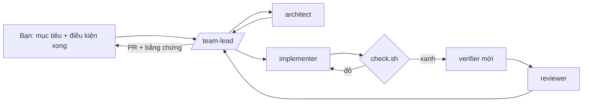

# Agents Team Coding

Bộ khởi động để xây dựng **đội AI agent hỗ trợ lập trình** trên Claude Code, dựa trên nghiên cứu về *Agentic Engineering* từ các chia sẻ của **Lydia Hallie** (Anthropic, Claude Code team) và **Lauren Tan** (SpaceXAI, trước đây ở Cursor, tác giả pstack).

> **Ý tưởng cốt lõi:** giới hạn của một đội agent không nằm ở *số agent* mà ở *mức độ bạn tin được kết quả của chúng*. Vì vậy hãy đầu tư vào kiểm chứng trước, song song hoá sau.

## Đọc gì trước

1. [docs/01-nghien-cuu-agentic-engineering.md](docs/01-nghien-cuu-agentic-engineering.md): nghiên cứu chi tiết hai diễn giả, điểm hội tụ, 10 nguyên tắc, nguồn trích dẫn.
2. [docs/02-kien-truc-agent-team.md](docs/02-kien-truc-agent-team.md): kiến trúc đội, các vai, luồng chuẩn, lớp kiểm soát, ma trận tự chủ.
3. [docs/03-lo-trinh-trien-khai.md](docs/03-lo-trinh-trien-khai.md): 6 cấp độ trưởng thành, kế hoạch 30 ngày, cách cài, prompt mẫu, chỉ số.
4. [docs/04-thu-nghiem-vnstock-dashboard.md](docs/04-thu-nghiem-vnstock-dashboard.md): triển khai thử vào một dự án Python thật trên Windows, từng bước.

## Trong bộ kit có gì

```
CLAUDE.md                         quy ước ngắn + bảng Rule ↔ Thứ thực thi
.claude/
  settings.json                   permissions + 3 hook
  agents/
    architect.md                  thiết kế, chỉ đọc (opus)
    implementer.md                code một đơn vị việc (model của phiên)
    verifier.md                   kiểm chứng độc lập trên app thật (sonnet)
    reviewer.md                   review đối kháng, chỉ lỗi correctness (opus)
    gardener.md                   biến lỗi lặp lại thành cấu trúc (opus, có memory)
  skills/
    team-lead/                    /team-lead: điều phối đội + 5 playbook
    create-verify-skill/          /create-verify-skill: sinh skill verify-<app> kèm feature map
    correct/                      /correct: mã hoá bài học vào type, lint, hook, test
    agent-audit/                  /agent-audit: dò sự cố từ file phiên, sửa kèm test, mở PR nháp
  hooks/
    stop-gate.sh                  Stop: chưa được "báo xong" khi check còn đỏ
    guard-irreversible.sh         PreToolUse(Bash|PowerShell): hỏi người trước force-push, deploy, xoá dữ liệu...
    post-edit-format.sh           PostToolUse: format bằng formatter dự án đã cấu hình
scripts/
  check.sh                        THE check: một lệnh cho agent, hook và CI
  validate-kit.sh                 kiểm tra frontmatter, link, hook, cú pháp shell (chỉ file của kit)
  test-hooks.sh                   test hành vi của 3 hook
  guard-ask-floor                 sàn số ca "phải hỏi" của guard: được tăng, không được giảm
  audit-agent.sh / .py            dò sự cố từ file phiên Claude Code (chỉ đọc)
  test-audit.sh                   test của script dò sự cố
  install-kit.sh                  cài kit vào một repo khác bằng một lệnh
  test-install.sh                 test của installer
  check.local.sh                  check riêng của repo kit (không chép sang dự án khác)
templates/agent-team-rules.md     quy ước đội, dùng khi dự án đã có CLAUDE.md
examples/vnstock-dashboard/       check.local.sh mẫu cho dự án Python + pytest
.github/workflows/check.yml       CI chạy ./scripts/check.sh
```

## Bắt đầu nhanh

```bash
# 1. Cài kit vào dự án của bạn, trên một branch mới (chi tiết: docs/03, mục 3)
cd /đường/dẫn/tới/dự-án && git switch -c chore/agent-team
/đường/dẫn/tới/Agents-Team-coding/scripts/install-kit.sh .
# 2. Khai báo check thật của dự án
cat > scripts/check.local.sh <<'EOF'
#!/usr/bin/env bash
set -euo pipefail
npm run -s lint && npm run -s typecheck && CI=1 npm test
EOF
./scripts/check.sh
# 3. Mở Claude Code trong dự án
claude
```

Trong Claude Code:

```text
/create-verify-skill
/team-lead xuất CSV bị trùng dòng khi retry. tái hiện bằng test fail trước, rồi sửa và kiểm chứng.
/correct
```

## Đội làm việc thế nào



## Ghi công

- Nhiều skill trong kit được phỏng theo [pstack](https://github.com/cursor/plugins/tree/main/pstack) của Lauren Tan (MIT License, © 2026 Lauren Tan), cụ thể là `create-verification-skill`, `correct` và playbook chạy qua đêm.
- Các thực hành về context, kiểm chứng, subagents, agent teams và hooks theo [Best practices for Claude Code](https://code.claude.com/docs/en/best-practices), do Lydia Hallie công bố.
