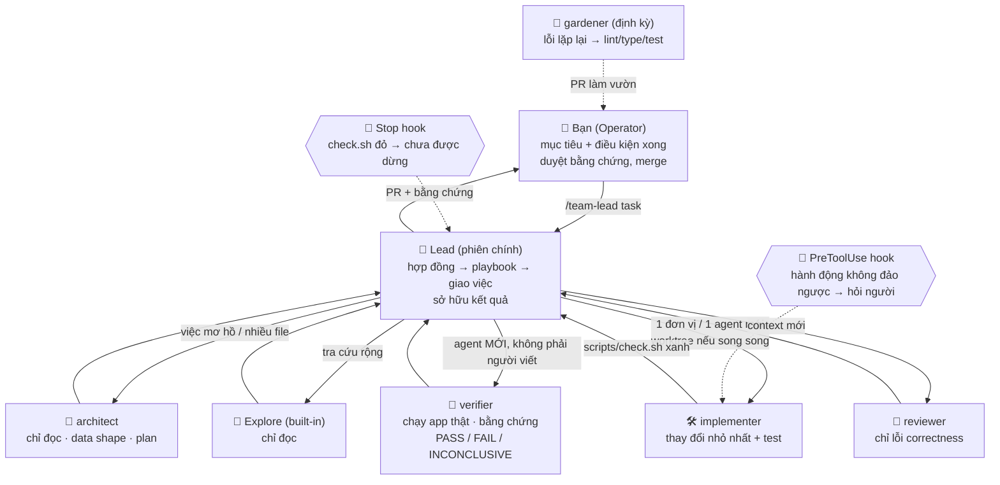

# Kiến trúc đội AI Agent lập trình

Tài liệu này biến các nguyên tắc ở [01-nghien-cuu-agentic-engineering.md](./01-nghien-cuu-agentic-engineering.md) thành một thiết kế đội cụ thể trên **Claude Code**. Mọi thành phần được nhắc tới đều có sẵn trong repo này, ở thư mục `.claude/` và `scripts/`.

## 1. Sơ đồ tổng thể



## 2. Vai trò

| Vai trò | File | Trách nhiệm | Công cụ | Model / effort | Không được |
|---|---|---|---|---|---|
| **Operator** (bạn) | — | Đặt mục tiêu và điều kiện xong; duyệt bằng chứng; quyết định việc không đảo ngược được; merge | — | — | Bị kéo vào từng bước nhỏ |
| **Lead** | [`.claude/skills/team-lead/`](../.claude/skills/team-lead/SKILL.md) | Lập hợp đồng task, chọn playbook, viết brief, giao việc, tổng hợp, sở hữu kết quả | Tất cả | Model của phiên | Chuyển tiếp nguyên văn lời subagent; tự chấm bài của chính mình |
| **architect** | [`.claude/agents/architect.md`](../.claude/agents/architect.md) | Data shape, interface, các phương án, kế hoạch gồm các đơn vị kiểm chứng được | Read, Grep, Glob, Bash | `opus`, high | Sửa file |
| **implementer** | [`.claude/agents/implementer.md`](../.claude/agents/implementer.md) | Thay đổi nhỏ nhất, test hành vi, chạy `scripts/check.sh` | Đọc + ghi + Bash | `inherit` | Tắt test, nuốt lỗi, mở rộng phạm vi |
| **verifier** | [`.claude/agents/verifier.md`](../.claude/agents/verifier.md) | Kiểm chứng độc lập trên app thật, thu bằng chứng | Read, Grep, Glob, Bash | `sonnet`, medium | Sửa code; làm yếu hành trình kiểm chứng để pass |
| **reviewer** | [`.claude/agents/reviewer.md`](../.claude/agents/reviewer.md) | Review đối kháng diff trong context mới | Read, Grep, Glob, Bash | `opus`, high | Bắt bẻ style; đề xuất over-engineering |
| **gardener** | [`.claude/agents/gardener.md`](../.claude/agents/gardener.md) | Biến lỗi lặp lại thành cấu trúc; xoá cách cũ; tỉa CLAUDE.md | Đọc + ghi + Bash, memory `project` | `opus`, high | Thêm chữ vào CLAUDE.md khi một check làm được việc đó |
| **Explore** | built-in | Tìm kiếm rộng, chỉ đọc | Chỉ đọc | — | — |

Vì sao lại là các vai này:

- **architect, implementer, verifier/reviewer** là ba bước *explore → implement → verify* mà cả Anthropic lẫn Lauren Tan đều dùng. Tách verifier và reviewer khỏi implementer để **người viết không tự chấm bài**.
- Theo Lauren, verifier dùng model **nhanh hơn**: việc kiểm chứng nhiều và lặp lại. Reviewer và architect dùng model **mạnh nhất**, vì đây là việc phán đoán.
- **gardener** hiện thực hoá ý "người làm vườn" và skill `/correct`. Đây là vai tạo ra *hiệu ứng tích luỹ*: đội tốt lên theo thời gian.
- Chỉ có **5 vai tự định nghĩa**. Mỗi description chiếm context. Thêm vai chỉ khi một loại việc lặp lại đủ nhiều để đáng có system prompt riêng.

> Muốn đổi model? Sửa trường `model` (`opus`, `sonnet`, `haiku`, `fable`, `inherit` hoặc model ID đầy đủ) và `effort` (`low`…`max`) trong frontmatter của từng agent.

## 3. Luồng chuẩn cho một task

1. **Hợp đồng.** Lead viết lại: mục tiêu, **điều kiện xong dạng pass/fail**, ràng buộc (thứ không được đổi) và mức tự chủ. Nếu bạn không nêu điều kiện xong, lead tự đề xuất một điều kiện kiểm tra được rồi làm tiếp.
2. **Phân loại → playbook.** Có 5 loại: điều tra, sửa bug, tính năng, refactor, chạy dài/qua đêm. Mỗi playbook có trong [`.claude/skills/team-lead/playbooks/`](../.claude/skills/team-lead/playbooks/).
3. **Thiết kế** (chỉ khi việc mơ hồ hoặc chạm nhiều file): giao cho architect. Nếu diff mô tả được trong một câu thì bỏ qua bước này.
4. **Thực thi.** Mỗi đơn vị kiểm chứng được giao cho **một implementer mới**. Các đơn vị độc lập, *không chung file*, có thể chạy song song với `isolation: "worktree"`.
5. **Cổng xanh.** `./scripts/check.sh` phải pass. Stop hook thực thi điều này một cách tất định.
6. **Kiểm chứng độc lập.** Verifier mới chạy app thật theo skill `verify-<app>` của dự án và trả về PASS / FAIL / INCONCLUSIVE kèm bằng chứng.
7. **Review đối kháng.** Reviewer đọc diff kèm hợp đồng, chỉ báo lỗi correctness hoặc thiếu yêu cầu.
8. **Bàn giao.** Commit nhỏ, có thứ tự. PR kèm bằng chứng. Báo cáo cho bạn theo format cố định: kết quả, bằng chứng, điều chưa kiểm chứng, quyết định cần bạn.
9. **Học.** Nếu bạn phải sửa cùng một lỗi lần thứ hai, chạy `/correct` để mã hoá bài học vào cấu trúc. Bạn tìm ra bug trong việc đội đã báo xong là **lỗi lọt lưới**: đội sửa cả cổng kiểm (thêm hành trình tái hiện vào feature map của `verify-<app>`, ghi "Vì sao lọt"), không chỉ sửa bug. Mục I của `scripts/audit-agent.sh` liệt kê những lần bạn phải sửa agent, là nguồn đầu tiên của `/correct`.

## 4. Subagents hay agent teams?

| | Subagents (mặc định của kit) | Agent teams (bật khi cần) |
|---|---|---|
| Giao tiếp | Báo kết quả một chiều về lead | Teammate nhắn trực tiếp cho nhau; task list chung |
| Chi phí token | Thấp hơn | Cao hơn nhiều; tăng tuyến tính theo số teammate |
| Hợp với | Việc tập trung, chỉ cần kết quả: implement, verify, review | Nghiên cứu nhiều góc, review song song theo nhiều "lăng kính", debug bằng giả thuyết cạnh tranh |
| Bật bằng | Có sẵn | `"env": {"CLAUDE_CODE_EXPERIMENTAL_AGENT_TEAMS": "1"}` trong settings |

Khuyến nghị:
- **Bắt đầu với subagents.**
- Bật agent teams khi đã quen. Dùng nó trước hết cho **review và nghiên cứu**, chưa dùng cho viết code song song.
- Đội 3–5 teammate là đủ, mỗi người sở hữu một nhóm file riêng.
- Các định nghĩa trong `.claude/agents/` dùng lại được làm teammate, ví dụ: *"Spawn a teammate using the reviewer agent type…"*.

> Lưu ý từ tài liệu Claude Code: khi đã bật agent teams, subagent nào được Claude *đặt tên* sẽ chạy dưới dạng teammate, nên team có thể tự hình thành. Vì vậy kit **không** bật agent teams mặc định.

## 5. Các lớp kiểm soát (trust ladder trong kit)

| Tầng | Trong kit | Tính chất |
|---|---|---|
| 1. Codebase | Của dự án bạn: một cách đúng cho mỗi việc, xoá code chết | Mạnh nhất. Agent chép thứ nó thấy |
| 2. Type, lint, CI | [`scripts/check.sh`](../scripts/check.sh): **một lệnh duy nhất**, chạy y hệt ở local và CI ([`.github/workflows/check.yml`](../.github/workflows/check.yml)) | Tất định |
| 3. Hooks | [`stop-gate.sh`](../.claude/hooks/stop-gate.sh) không cho agent "báo xong" khi check còn đỏ; [`guard-irreversible.sh`](../.claude/hooks/guard-irreversible.sh) buộc hỏi người trước hành động không đảo ngược được; [`post-edit-format.sh`](../.claude/hooks/post-edit-format.sh) format sau mỗi lần sửa | Tất định, ngay trong phiên |
| 4. Agents, skills, CLAUDE.md | `.claude/agents/`, `.claude/skills/`, [`CLAUDE.md`](../CLAUDE.md) | Agent thường tuân theo nhưng có thể bỏ qua |
| 5. Người review | Bạn, trên PR có bằng chứng | Không mở rộng được theo số PR |

Quy tắc: **mỗi rule trong CLAUDE.md phải ghi rõ thứ thực thi nó.** Bảng rule nằm ở cuối [`CLAUDE.md`](../CLAUDE.md). Rule nào chỉ có "lời nhắc" làm thứ thực thi mà vẫn bị vi phạm lặp lại thì phải được đẩy lên tầng cao hơn.

## 6. Ma trận tự chủ

| Loại hành động | Ví dụ | Chính sách | Thực thi bởi |
|---|---|---|---|
| Đọc, phân tích | grep, đọc file, `git log` | Tự làm | `permissions.allow` |
| Sửa code trong branch hoặc worktree | Edit, commit cục bộ | Tự làm | Permission mode, auto mode |
| Hành động ra ngoài nhưng đảo ngược được | Mở PR, comment, chạy CI | Tự làm, báo lại | Auto mode classifier |
| **Không đảo ngược được** | Force-push, push thẳng lên `main`, `git reset --hard`, `rm -rf` thư mục rộng, `DROP TABLE`, deploy, publish | **Luôn hỏi người** | `guard-irreversible.sh` (PreToolUse → `ask`) |
| Bí mật | `.env`, khoá, `secrets/` | Không đọc | `permissions.deny` |

## 7. Brief chuẩn khi giao việc cho subagent

Subagent **không thấy** lịch sử hội thoại của lead. Brief phải tự đứng được:

```text
MỤC TIÊU: <một câu, kết quả người dùng thấy được>
ĐIỀU KIỆN XONG: <pass/fail; ví dụ "./scripts/check.sh exit 0 và test X pass">
PHẠM VI: chỉ sửa <file/thư mục>. KHÔNG đụng: <...>
NGỮ CẢNH: đọc <đường dẫn file>; plan ở <đường dẫn>; quyết định trước đó: <...>
BÀN GIAO: file đã đổi, lệnh đã chạy + output tóm tắt, điều CHƯA kiểm chứng được
```

Truyền **đường dẫn file**, không dán nội dung. Mỗi vòng sửa giao cho một agent mới, kèm brief gốc, các chỉ thị sau đó và báo cáo của agent trước.

## 8. Nếu bạn dùng Cursor hoặc Grok thay vì Claude Code

Các ý tưởng này độc lập với công cụ. Bảng đối chiếu:

| Khái niệm | Claude Code (kit này) | Cursor + pstack |
|---|---|---|
| Lead / router | skill `/team-lead` | `/poteto-mode` |
| Playbook | `team-lead/playbooks/*.md` | `poteto-mode/playbooks/*.md` (23 playbook) |
| Verification skill | `/create-verify-skill` → `verify-<app>` | `/create-verification-skill` |
| Mã hoá lỗi lặp lại | `/correct` + agent `gardener` | `/correct` |
| Vòng lặp | `/goal`, `/loop`, `/schedule`, Stop hook | `/loop`, Projects, automations |
| Review đa model | `reviewer` (đổi `model`) + `/code-review` | `/interrogate` |

Nếu bạn dùng Cursor, có thể cài trực tiếp pstack bằng `/add-plugin pstack`.
